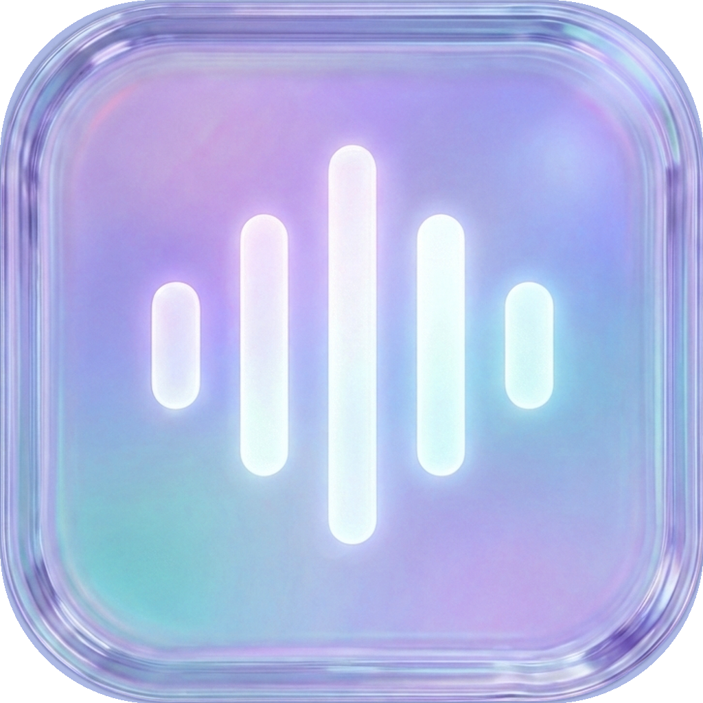

<p align="center">
  
</p>

<h1 align="center">TellWell</h1>

<p align="center">
  Private dictation for your Mac. Hold a key, speak, and clean text appears wherever you're typing.
</p>

<p align="center">
  <a href="https://ayushpatnaikgit.github.io/tellwell/">Website</a> ·
  <a href="https://github.com/ayushpatnaikgit/tellwell-android">TellWell for Android</a>
</p>

Install TellWell and its on-device engine (Apple Silicon, macOS 14+) with one command:

```sh
curl -fsSL https://ayushpatnaikgit.github.io/tellwell/install.sh | sh
```

It checks the app against the release's published SHA-256, installs the
[freeflow-local](https://github.com/ayushpatnaikgit/freeflow-local) engine, starts it at login and connects the two.
Run it again to update.

TellWell is free. If it helps you, a star on GitHub helps other people find it.

---

TellWell is a fork of [FreeFlow](https://github.com/zachlatta/freeflow) by Zach Latta, the free and open-source
Mac dictation app. It keeps everything FreeFlow does and adds a focus on running entirely on your own Mac: speech
recognition on the Apple Neural Engine and a small cleanup model fine-tuned for dictation, through the
[freeflow-local](https://github.com/ayushpatnaikgit/freeflow-local) engine.

**Status: early.** TellWell isn't signed with an Apple Developer ID; the one-line installer avoids macOS's
"could not verify" prompt. From 0.2.1, releases are signed with a self-signed certificate (SHA-1
`F37D1A1521D7E1871ED0CDEE2009D5636DA9ABD2`), so macOS recognises each update as the same app and your Microphone,
Accessibility and Screen Recording permissions carry over. You can check a copy with
`codesign -dr - /Applications/TellWell.app`. TellWell installs alongside FreeFlow without sharing settings or
permissions.

Thanks to Zach Latta and the FreeFlow contributors, including [@marcbodea](https://github.com/marcbodea) for
maintaining FreeFlow. TellWell is not affiliated with or endorsed by the FreeFlow project.

## Build from source

```sh
git clone https://github.com/ayushpatnaikgit/tellwell.git && cd tellwell
make ARCH="$(uname -m)" CODESIGN_IDENTITY=-      # builds "TellWell Dev.app" in build/
make APP_NAME=TellWell BUNDLE_ID=io.github.ayushpatnaikgit.tellwell ARCH="$(uname -m)" CODESIGN_IDENTITY=-
```

## Quick Start

1. Run the one-line command above. It installs TellWell and the on-device engine (models download once, about 2 GB).
2. Open TellWell and allow Microphone and Accessibility, plus Screen Recording if you want names on screen spelled right.
3. Hold `Fn` to talk, or tap `Command-Fn` to start and stop dictation. The cleaned-up text is pasted into the current text field.

## Features

- **Runs on your Mac:** speech recognition on the Apple Neural Engine and a cleanup model fine-tuned for dictation,
  through the freeflow-local engine. There is no API key and no cloud service.
- **Cleanup that types what you meant:** removes fillers and applies "no wait, I mean" corrections without rewriting
  what you said.
- **Context-aware spelling:** words on screen and in your custom vocabulary are used to fix mishearings of names and
  terms.
- **Custom shortcuts:** hold-to-talk and toggle shortcuts, double-tap to lock recording, and a per-shortcut choice
  between cleanup and your exact words.
- **Original-field insertion (opt in):** keeps dictation tied to the field where it started when you switch windows.

TellWell drops some FreeFlow features to stay simple and local: cloud providers, Edit Mode, custom prompts, output
language translation, voice macros and the Run Log.

## Privacy

Your audio, transcripts and screenshots stay on your Mac: TellWell sends them only to the engine at
`127.0.0.1:8081`. Recent dictations are kept in memory for the menu bar's History list and are gone when TellWell quits.
The only network requests TellWell makes are update checks against its GitHub releases.

## Contributing

See [CONTRIBUTING.md](CONTRIBUTING.md) for how to set up the project, build, test, and submit changes.

## License

Licensed under the MIT license.
